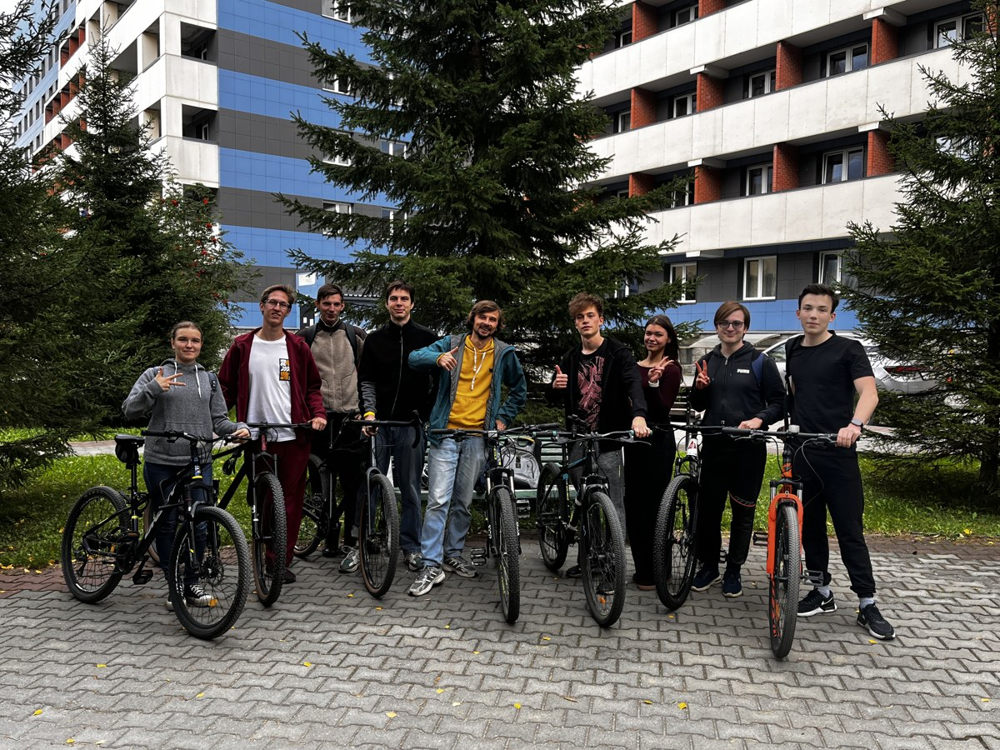

On 5 September we rode to Berdsk. This has become an annual outing with students who have already been through Structure of Matter, and it is a good sign that they still turn up for it once the exam is safely behind them.

<figure class="panel-figure">
  
  <figcaption>Before the start, on 5 September 2026.</figcaption>
</figure>

Nine of us set off, on a mixed fleet, at the pace of the slowest bike. The course itself is easier to teach after a day like this. It is one thing to talk about a system at rest and quite another to arrive somewhere under your own power, and the conversation on the way covers more ground than any seminar.
