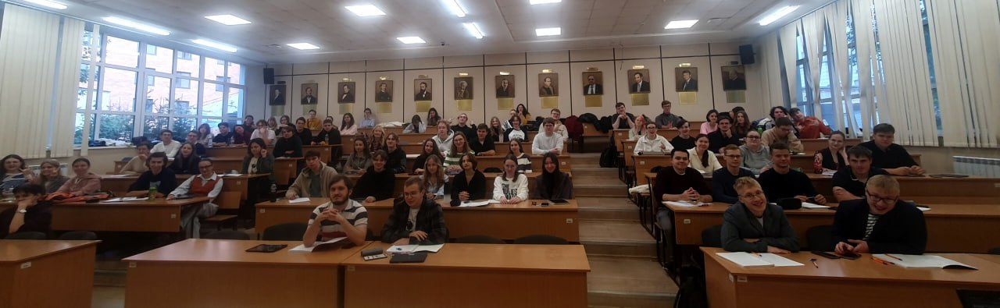

The autumn term started this week, and Structure of Matter is running again, the annual third-year course at the Department of Natural Sciences, NSU.

<figure class="panel-figure">
  
  <figcaption>The first lecture of the autumn term, Department of Natural Sciences, NSU.</figcaption>
</figure>

The first lecture is always a good measurement in its own right. The hall is full, nobody has missed anything yet, and the portraits on the wall watch to see how long that lasts. This year the course keeps the same shape, from the quantum description of a single atom through to the properties of condensed matter, with the seminars following a week behind the lectures.

Lecture notes and the term plan are on the <a href="/teaching/2022-teaching-2">course page</a>.
